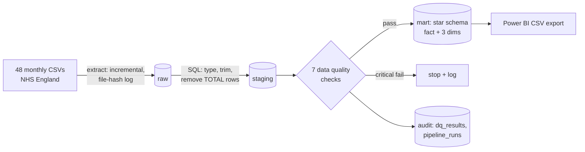

# NHS A&E Data Pipeline (Python + PostgreSQL) → Power BI star schema

An automated, tested ETL pipeline that loads **48 monthly NHS England A&E files** into **PostgreSQL**, cleans and validates them, and builds a **star schema** ready for Power BI.

**Tools:** Python (Pandas, SQLAlchemy), PostgreSQL 16, SQL, pytest, Docker Compose, GitHub Actions



## What it does
| Layer | Detail |
|---|---|
| **Extract** | Loads only **new** files (MD5 hash log in `raw.load_log`) → incremental and **idempotent**; warns on unexpected columns, fails on missing ones |
| **Staging** | Types all columns, trims region names, parses period labels to dates, separates the published TOTAL rows (5 different spellings, one hidden under a month label) |
| **Data quality** | 7 automated checks logged to `audit.dq_results`: duplicates, negative values, breaches > attendances, date parsing, **reconciliation of provider rows to published totals**, missing regions. Critical failures stop the run before marts are rebuilt |
| **Mart** | Star schema: `fact_ae_monthly` (9,623 rows) + `dim_date`, `dim_provider`, `dim_region`, with primary and foreign keys |
| **Export** | CSVs for Power BI in `powerbi/data/` |
| **Audit** | Every run logged in `audit.pipeline_runs` (files, rows, duration) |

## Results from the runs
| Run | Files loaded | Rows loaded | Time |
|---|---|---|---|
| Initial load (Apr 2022 – Feb 2026) | 47 | 9,471 | 1.6 s |
| New month arrives (Mar 2026) | **1** | 200 | 0.4 s |
| Re-run, nothing new | **0** | 0 | 0.5 s |

- All 7 data quality checks passed; provider figures reconcile to NHS England's published totals with **0 difference**.
- Output validated against the separate analysis project: March 2026 = 2,432,253 attendances, 77.1% within 4 hours.
- **4 tests pass** (`pytest`): 3 unit tests + 1 end-to-end test that runs the pipeline twice on a test database and checks idempotency.

## Run it
```bash
docker compose up -d                  # PostgreSQL
pip install -r requirements.txt
python -m pipeline.run                # full / incremental load
pytest -q                             # tests
```
Set `NHS_AE_DB_URL` to use another database. The dashboard build guide is in `powerbi/BUILD_GUIDE.md`.

## Data
NHS England, A&E Attendances and Emergency Admissions (monthly provider-level CSVs), Open Government Licence v3.0 — https://www.england.nhs.uk/statistics/statistical-work-areas/ae-waiting-times-and-activity/
